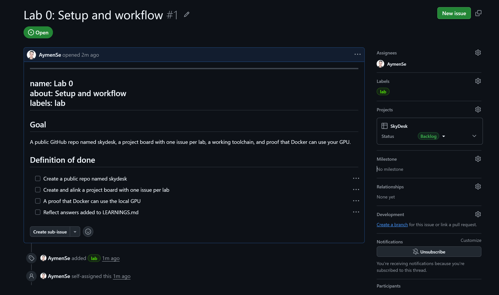
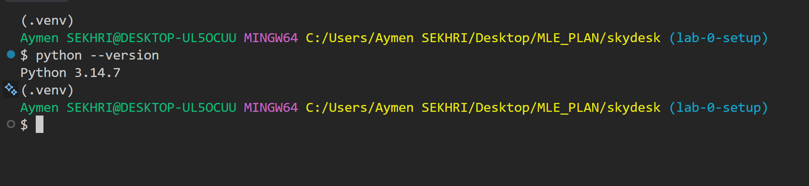
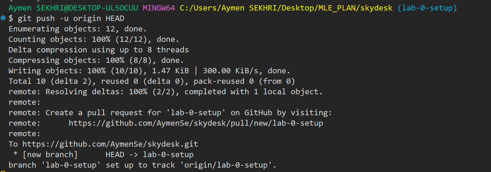
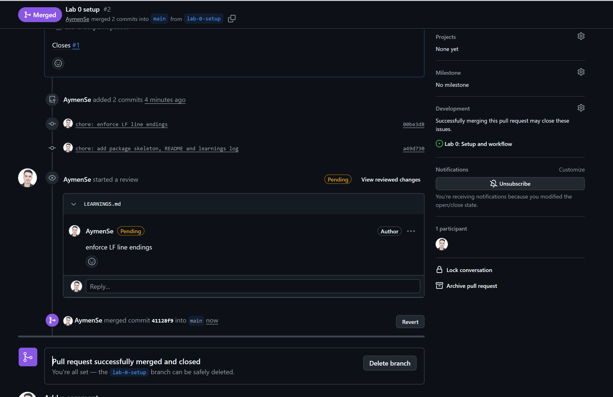

# Lab 0: Setup and workflow

This is my log of Lab 0 from the SkyDesk lab guide: every step I took and every command I ran.

| | |
| --- | --- |
| Repo | [AymenSe/skydesk](https://github.com/AymenSe/skydesk) (private until Lab 8) |
| Issue | #1 Lab 0: Setup and workflow |
| Pull request | #2 Lab 0 setup, merged into `main` as `41128f9` |
| Machine | Windows, Git Bash (MINGW64), VS Code, Docker Desktop with the WSL 2 engine |
| Local Python | 3.14.7 in `.venv` (the Docker images use Python 3.12) |

## 1. Bootstrap the repository (directly on `main`)

I created the repo on GitHub with an MIT license and committed the base files straight to `main`, 5 commits in total:

- `LICENSE` (the initial commit)
- `.gitignore`: Python caches, `.venv/`, `artifacts/`, `.env`, `secrets/`
- `pyproject.toml`: Ruff and pytest settings

From this point on, every change goes through a branch and a pull request.

## 2. Board, label and the Lab 0 issue (GitHub web UI)

1. **Board:** Projects tab → Link a project → New project → Board layout. I named it **SkyDesk**, with the columns Backlog, In progress and Done.
2. **Label:** Issues → Labels → New label → `lab`. The issue template's `labels: lab` line only applies labels that already exist.
3. **Issue:** Issues → New issue → Blank issue, because the template isn't on `main` yet. The title is **Lab 0: Setup and workflow** (#1). It has the `lab` label, is assigned to me, and is on the SkyDesk board with status Backlog.

The issue's definition of done:

- [ ] Create a public repo named skydesk
- [ ] Create and link a project board with one issue per lab
- [ ] A proof that Docker can use the local GPU
- [ ] Reflect answers added to LEARNINGS.md



Lesson learned: `name:`, `about:` and `labels:` are front matter, which GitHub only reads inside a template file. When I pasted them into a blank issue, they showed up as text at the top.

## 3. Create the branch

```bash
git switch -c lab-0-setup
```

## 4. Add the package skeleton and repo files

Git doesn't track empty folders, so each Python package gets an empty `__init__.py`:

```bash
mkdir -p skydesk/api/routes tests
touch skydesk/__init__.py skydesk/api/__init__.py skydesk/api/routes/__init__.py \
      skydesk/core/__init__.py skydesk/worker/__init__.py
printf "# SkyDesk\n\nAirline support backend for Nimbus Air (fictional), built lab by lab.\n" > README.md
echo "* text=auto eol=lf" > .gitattributes
```

Why `.gitattributes`: on Windows, Git can check files out with CRLF line endings. Shell scripts with CRLF fail in Linux containers and in CI with a `bad interpreter` error, so this forces LF for every text file.

The other files in this lab:

- `.github/ISSUE_TEMPLATE/lab.md`
- `.github/pull_request_template.md`
- `LEARNINGS.md`
- `.env.example`, empty until Lab 6

`tests/` stays empty, so Git ignores it until Lab 2 adds the first test file.

## 5. Create the Python environment

On Windows, the venv's activate script lives in `Scripts`, not `bin`.

```bash
py -m venv .venv
source .venv/Scripts/activate
python --version        # Python 3.14.7
```



## 6. Commit and push

```bash
git add .gitattributes
git commit -m "chore: enforce LF line endings"                          # 00be3d8
git add skydesk README.md LEARNINGS.md .env.example
git commit -m "chore: add package skeleton, README and learnings log"   # a49d730
git push -u origin HEAD
```

The end of the push output:

```text
To https://github.com/AymenSe/skydesk.git
 * [new branch]      HEAD -> lab-0-setup
branch 'lab-0-setup' set up to track 'origin/lab-0-setup'.
```



## 7. Pull request #2 and the merge

1. I opened the PR from the link Git printed: `https://github.com/AymenSe/skydesk/pull/new/lab-0-setup`.
2. I titled it **Lab 0 setup**. The PR template doesn't prefill yet because it isn't on `main`, so I pasted its sections by hand and wrote `Closes #1`.
3. I reviewed the diff in the Files changed tab and commented on `LEARNINGS.md`: "enforce LF line endings".
4. I merged it into `main` as `41128f9`. Because the PR says `Closes #1`, merging it closes issue #1 automatically.



## Still to do

- [ ] **Submit the pending review.** My comment on PR #2 is marked **Pending**, which means only I can see it. Go to Files changed → Finish your review → Comment.
- [ ] **Delete the `lab-0-setup` branch** with the button at the bottom of PR #2.
- [ ] **Sync, clean up and tag:**

  ```bash
  git switch main
  git pull
  git branch -D lab-0-setup   # capital -D works whether GitHub squashed or made a merge commit
  git tag lab-0
  git push --tags
  ```

- [ ] **Check that the templates reached `main`.** PR #2 has no separate templates commit, so confirm they're there:

  ```bash
  git ls-tree -r --name-only main .github
  # expected: .github/ISSUE_TEMPLATE/lab.md and .github/pull_request_template.md
  ```

  If they're missing, add them through a small branch and PR before creating more issues.

- [ ] **Tidy issue #1.** Delete the front matter lines from its description, and check that the board moved it to Done when it closed.
- [ ] **Run the GPU check** and paste the GPU line into `LEARNINGS.md` on the next branch:

  ```bash
  nvidia-smi   # "CUDA Version" in the top-right corner must be 12.4 or higher
  docker run --rm --gpus all nvidia/cuda:12.4.1-base-ubuntu22.04 nvidia-smi
  # expected: "GeForce GTX 1050" with about 4096MiB of memory
  ```

  Docker Desktop's WSL 2 engine gives containers GPU access, so the `nvidia-ctk` steps from the Linux instructions don't apply on Windows.

- [ ] **Create the Lab 1 to Lab 9 issues** from the Lab template and add them to the board.

## Notes

- The repo stays private until Lab 8, when branch protection needs it public on the free plan. The "public repo" item in issue #1 waits until then.
- The local venv runs Python 3.14.7. The Docker images use `python:3.12-slim`.
